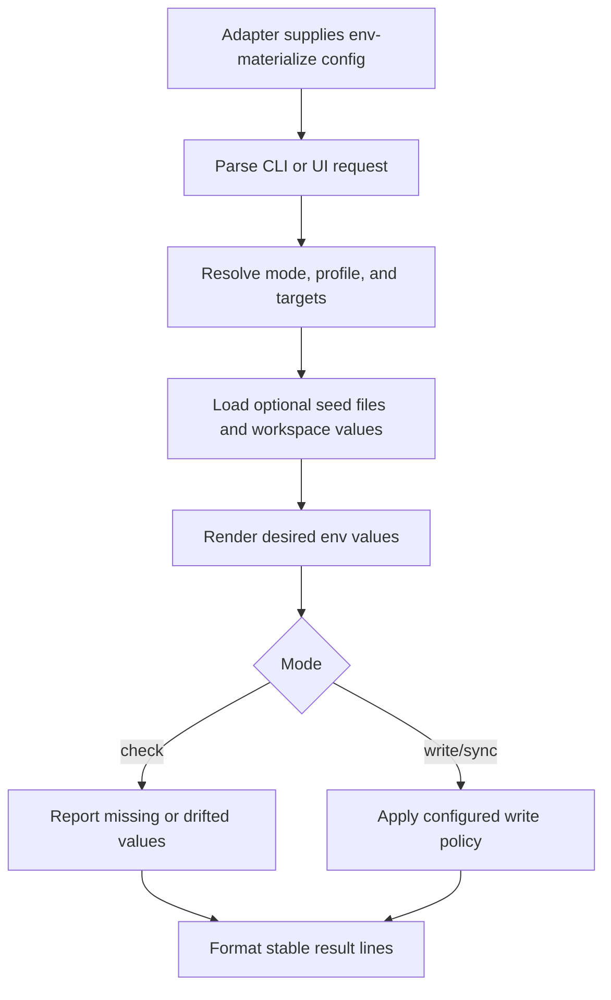

# @gg-utils/env-materialize-kit

Reusable env materialization command, UI, and target orchestration primitives.

This kit sits above `@gg-utils/env-materialize-core`. It owns generic argv parsing, mode handling,
target resolution, seed loading, write policies, command previews, result formatting, and reusable
Ink/OpenTUI/classic menu models. Repository-specific targets, secret sources, labels, default values,
and command names belong in the consuming adapter.

## Install

```bash
npm install @gg-utils/env-materialize-kit@git+https://github.com/gg-utils/env-materialize-kit.git#v0.2.0
```

Package JSON form:

```json
{
  "dependencies": {
    "@gg-utils/env-materialize-kit": "git+https://github.com/gg-utils/env-materialize-kit.git#3ccfa96"
  }
}
```

## When To Use

- You are building an env materialization CLI around explicit config.
- You need reusable `--check`, `--write`, `--sync`, profile, and target parsing helpers.
- You need package-safe Ink/OpenTUI wizard models or renderers.
- You need to preview commands before executing adapter-owned scripts.
- You need deterministic result lines for CI or logs.

Skip this package when you only need low-level `.env` parsing; use
`@gg-utils/env-materialize-core` directly.

## Public Surfaces

| Import | Purpose |
|---|---|
| `@gg-utils/env-materialize-kit/cli-args` | Parse and serialize CLI options. |
| `@gg-utils/env-materialize-kit/cli-runner` | Config-bound run loop and exit policy. |
| `@gg-utils/env-materialize-kit/modes` | Mode and target constants. |
| `@gg-utils/env-materialize-kit/seed-files` | Optional seed-file loading helpers. |
| `@gg-utils/env-materialize-kit/target-files` | Config-driven target resolution. |
| `@gg-utils/env-materialize-kit/target-runner` | Iterate targets and connect render/write callbacks. |
| `@gg-utils/env-materialize-kit/write-target-file` | Apply write and sync policies. |
| `@gg-utils/env-materialize-kit/ink-app` | Reusable Ink UI renderer. |
| `@gg-utils/env-materialize-kit/opentui-app` | Reusable OpenTUI UI renderer. |
| `@gg-utils/env-materialize-kit/ui-launcher` | Shared UI launcher flag parsing and spawn helpers. |

## Quick Start

```ts
import {
  type EnvMaterializeKit_Mode,
  EnvMaterializeKit_modes,
  EnvMaterializeKit_parseCliArgs,
} from "@gg-utils/env-materialize-kit";

const logicalEnvironments = ["local", "ci"] as const;
const targets = ["web", "api"] as const;
type LogicalEnvironment = (typeof logicalEnvironments)[number];
type Target = (typeof targets)[number];

const parsed = EnvMaterializeKit_parseCliArgs({
  additionalOptions: [],
  argv: ["--logical-environment", "local", "--mode", "check", "--targets", "web"],
  currentWorkingDirectory: process.cwd(),
  defaultMode: "check",
  defaultTargets: targets,
  isLogicalEnvironmentId: (value): value is LogicalEnvironment =>
    logicalEnvironments.includes(value as LogicalEnvironment),
  isMode: (value): value is EnvMaterializeKit_Mode =>
    EnvMaterializeKit_modes.includes(value as EnvMaterializeKit_Mode),
  isTarget: (value): value is Target => targets.includes(value as Target),
  logicalEnvironmentLabels: logicalEnvironments,
  modeLabels: EnvMaterializeKit_modes,
});

if (parsed.kind === "parsed") {
  console.log(parsed.options.mode, parsed.options.targets);
}
```

## Operational Flow



## Development

```bash
git clone https://github.com/gg-utils/env-materialize-kit.git
cd env-materialize-kit
npm run type-check
npm test
npm run build
```

Use `npm ci` for exact-pinned local tools, `npm run lint` for zero-warning lint, and
`npm run check:dist` to verify committed build output.

## Layout

```text
.
|-- src/cli-args.ts              # CLI parser and serializer helpers
|-- src/cli-runner.ts            # Config-bound run loop
|-- src/target-files.ts          # Target resolution
|-- src/write-target-file.ts     # Write/sync policy application
|-- src/ink-app.tsx              # Ink renderer
|-- src/opentui-app.tsx          # OpenTUI renderer
|-- dist/                        # Checked-in build output
`-- package.json                 # Export map and Git dependencies
```

## Caveats

- The kit never decides which secrets or defaults are correct for a project.
- Adapter code must inject target definitions, labels, file paths, and render callbacks.
- UI components here are reusable shells; project copy and command names belong outside the package.

## Use from another repository

Requires Node `>=22.0.0 <27`. Built ESM JavaScript and declarations are included; no install scripts or consumer build step is needed.

```json
{
  "dependencies": {
    "@gg-utils/env-materialize-kit": "git+https://github.com/gg-utils/env-materialize-kit.git#v0.2.0"
  }
}
```

The kit pins its core to `env-materialize-core#v0.2.0`. React and Ink are runtime dependencies for the exported UI components.

### Read-only file check API

There is no key-name presence/missing report and no standalone CLI binary. Existing check mode compares whole file content, including values and formatting, without writing files or returning values. A consumer can invoke it directly:

```js
import { EnvMaterializeKit_writeTargetFile } from "@gg-utils/env-materialize-kit/write-target-file";
import { EnvMaterializeKit_formatResultLines } from "@gg-utils/env-materialize-kit/format-results";
import { EnvMaterializeKit_isCheckModeFailureResult } from "@gg-utils/env-materialize-kit/cli-runner";

// Supply desiredContent from the consuming repository's own renderer.
const result = EnvMaterializeKit_writeTargetFile({
  desiredContent,
  filePath: targetPath,
  mode: "check",
  referenceFilePath: referencePath,
  syncPolicy: { managedUrlKeys: [], placeholderExactValues: [], placeholderSubstrings: [] },
});
for (const line of EnvMaterializeKit_formatResultLines([result])) console.log(line);
process.exitCode = EnvMaterializeKit_isCheckModeFailureResult(result) ? 1 : 0;
```

Arguments: `desiredContent` is rendered env text, `filePath` is the target, and `mode` is `"check"`.
`referenceFilePath` and `syncPolicy` are required by the shared options type but are unused in check mode.
The returned object contains only `changed: false`, `filePath`, and `status` (`missing`, `drift`, or `unchanged`).
The formatter prints only status and path. This example exits 0 for unchanged and 1 for missing/drift.
I/O exceptions propagate; consumers own their error handling. The API itself returns an object, not an exit code.

The generic parser supports `--mode check` when the consuming adapter's `isMode` accepts `check`;
it also requires `--logical-environment <id>` and project-provided validators/defaults.
`EnvMaterializeKit_runCli` returns 1 for missing/drift results in check mode, otherwise 0 (including help),
and propagates parser/runner errors. Inject the package formatter to keep its output value-free.
