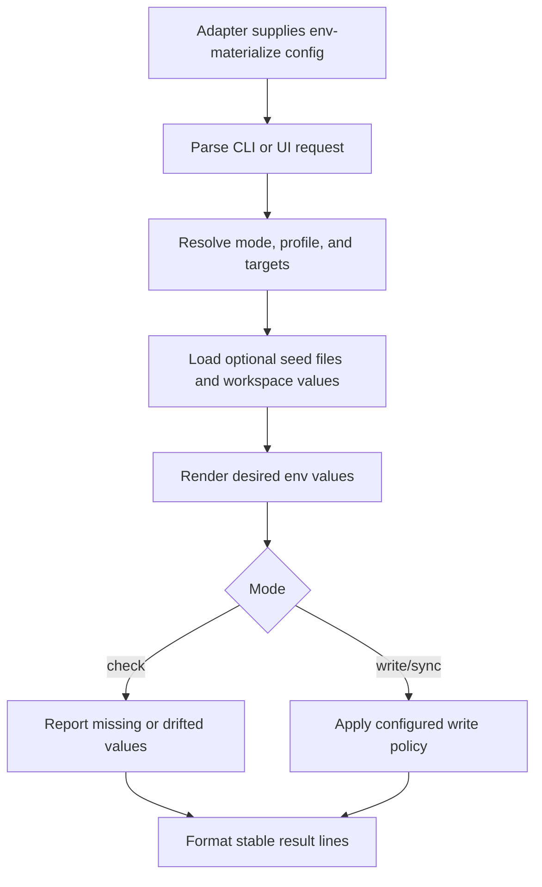

# @gg-utils/env-materialize-kit

Reusable env materialization command, UI, and target orchestration primitives.

This kit sits above `@gg-utils/env-materialize-core`. It owns generic argv parsing, mode handling,
target resolution, seed loading, write policies, command previews, result formatting, and reusable
Ink/OpenTUI/classic menu models. Repository-specific targets, secret sources, labels, default values,
and command names belong in the consuming adapter.

## Install

```bash
npm install @gg-utils/env-materialize-kit@git+https://github.com/gg-utils/env-materialize-kit.git#v0.4.0
```

Package JSON form:

```json
{
  "dependencies": {
    "@gg-utils/env-materialize-kit": "git+https://github.com/gg-utils/env-materialize-kit.git#v0.4.0"
  }
}
```

## When To Use

- You are building an env materialization CLI around explicit config.
- You need reusable `--check`, `--write`, `--sync`, profile, and target parsing helpers.
- You need package-safe Ink/OpenTUI wizard models or renderers.
- You need to preview commands before executing adapter-owned scripts.
- You need deterministic result lines for CI or logs.

Skip this package when you only need low-level `.env` parsing; use
`@gg-utils/env-materialize-core` directly.

## Public Surfaces

| Import | Purpose |
|---|---|
| `@gg-utils/env-materialize-kit/cli-args` | Parse and serialize CLI options. |
| `@gg-utils/env-materialize-kit/cli-runner` | Config-bound run loop and exit policy. |
| `@gg-utils/env-materialize-kit/modes` | Mode and target constants. |
| `@gg-utils/env-materialize-kit/seed-files` | Optional seed-file loading helpers. |
| `@gg-utils/env-materialize-kit/target-files` | Config-driven target resolution. |
| `@gg-utils/env-materialize-kit/target-runner` | Iterate targets and connect render/write callbacks. |
| `@gg-utils/env-materialize-kit/write-target-file` | Apply write and sync policies. |
| `@gg-utils/env-materialize-kit/seed-sources` | Pluggable seed sources and ordered seed layers with machine overrides. |
| `@gg-utils/env-materialize-kit/value-table` | Table-driven, pure value resolution. |
| `@gg-utils/env-materialize-kit/managed-keys` | Key-level check and write for partly managed env files, with name-only output. |
| `@gg-utils/env-materialize-kit/env-assignments` | Byte-preserving dotenv scanning and dotenv-safe value quoting (Node `util.parseEnv` grammar). |
| `@gg-utils/env-materialize-kit/atomic-file` | Crash-atomic, symlink-refusing text file writes that keep the destination's mode. |
| `@gg-utils/env-materialize-kit/contained-paths` | Reads that stay inside a root of a trusted tree and refuse a single symlink swap, and the parent-folder symlink check. |
| `@gg-utils/env-materialize-kit/ink-app` | Reusable Ink UI renderer. |
| `@gg-utils/env-materialize-kit/opentui-app` | Reusable OpenTUI UI renderer. |
| `@gg-utils/env-materialize-kit/ui-launcher` | Shared UI launcher flag parsing and spawn helpers. |

## Quick Start

```ts
import {
  type EnvMaterializeKit_Mode,
  EnvMaterializeKit_modes,
  EnvMaterializeKit_parseCliArgs,
} from "@gg-utils/env-materialize-kit";

const logicalEnvironments = ["local", "ci"] as const;
const targets = ["web", "api"] as const;
type LogicalEnvironment = (typeof logicalEnvironments)[number];
type Target = (typeof targets)[number];

const parsed = EnvMaterializeKit_parseCliArgs({
  additionalOptions: [],
  argv: ["--logical-environment", "local", "--mode", "check", "--targets", "web"],
  currentWorkingDirectory: process.cwd(),
  defaultMode: "check",
  defaultTargets: targets,
  isLogicalEnvironmentId: (value): value is LogicalEnvironment =>
    logicalEnvironments.includes(value as LogicalEnvironment),
  isMode: (value): value is EnvMaterializeKit_Mode =>
    EnvMaterializeKit_modes.includes(value as EnvMaterializeKit_Mode),
  isTarget: (value): value is Target => targets.includes(value as Target),
  logicalEnvironmentLabels: logicalEnvironments,
  modeLabels: EnvMaterializeKit_modes,
});

if (parsed.kind === "parsed") {
  console.log(parsed.options.mode, parsed.options.targets);
}
```

## Operational Flow



## Development

```bash
git clone https://github.com/gg-utils/env-materialize-kit.git
cd env-materialize-kit
npm run type-check
npm test
npm run build
```

Use `npm ci` for exact-pinned local tools, `npm run lint` for zero-warning lint, and
`npm run check:dist` to verify committed build output.

## Layout

```text
.
|-- src/cli-args.ts              # CLI parser and serializer helpers
|-- src/cli-runner.ts            # Config-bound run loop
|-- src/target-files.ts          # Target resolution
|-- src/write-target-file.ts     # Write/sync policy application
|-- src/ink-app.tsx              # Ink renderer
|-- src/opentui-app.tsx          # OpenTUI renderer
|-- dist/                        # Checked-in build output
`-- package.json                 # Export map and Git dependencies
```

## Caveats

- The kit never decides which secrets or defaults are correct for a project.
- Adapter code must inject target definitions, labels, file paths, and render callbacks.
- UI components here are reusable shells; project copy and command names belong outside the package.

## Use from another repository

Requires Node `>=22.0.0 <27`. Built ESM JavaScript and declarations are included; no install scripts or consumer build step is needed.

```json
{
  "dependencies": {
    "@gg-utils/env-materialize-kit": "git+https://github.com/gg-utils/env-materialize-kit.git#v0.4.0"
  }
}
```

The kit pins its core to `env-materialize-core#v0.3.0`. React and Ink are runtime dependencies for the exported UI components.

### Read-only file check API

Existing check mode compares whole file content, including values and formatting, without writing files or returning values. A consumer can invoke it directly:

```js
import { EnvMaterializeKit_writeTargetFile } from "@gg-utils/env-materialize-kit/write-target-file";
import { EnvMaterializeKit_formatResultLines } from "@gg-utils/env-materialize-kit/format-results";
import { EnvMaterializeKit_isCheckModeFailureResult } from "@gg-utils/env-materialize-kit/cli-runner";

// Supply desiredContent from the consuming repository's own renderer.
const result = EnvMaterializeKit_writeTargetFile({
  desiredContent,
  filePath: targetPath,
  mode: "check",
  referenceFilePath: referencePath,
  syncPolicy: { managedUrlKeys: [], placeholderExactValues: [], placeholderSubstrings: [] },
});
for (const line of EnvMaterializeKit_formatResultLines([result])) console.log(line);
process.exitCode = EnvMaterializeKit_isCheckModeFailureResult(result) ? 1 : 0;
```

Arguments: `desiredContent` is rendered env text, `filePath` is the target, and `mode` is `"check"`.
`referenceFilePath` and `syncPolicy` are required by the shared options type but are unused in check mode.
The returned object contains only `changed: false`, `filePath`, and `status` (`missing`, `drift`, or `unchanged`).
The formatter prints only status and path. This example exits 0 for unchanged and 1 for missing/drift.
I/O exceptions propagate; consumers own their error handling. The API itself returns an object, not an exit code.

The generic parser supports `--mode check` when the consuming adapter's `isMode` accepts `check`;
it also requires `--logical-environment <id>` and project-provided validators/defaults.
`EnvMaterializeKit_runCli` returns 1 for missing/drift results in check mode, otherwise 0 (including help),
and propagates parser/runner errors. Inject the package formatter to keep its output value-free.

### Key-name coverage (v0.3.0)

```sh
env-materialize-check-keys --template <path> --target <path> [--optional NAME ...] [--json]
```

Exit 0 means all required names exist, 1 means missing names or an absent target, and 2
means usage or I/O errors. Extras are informational. Output contains names only. Usage errors
do not echo arguments. An I/O error names the file path and the underlying file system error
(for example `ENOENT: no such file or directory`), which `checkKeys` also keeps as the
error's `cause`. No error message or cause ever contains a value: a failure that does not
come from the file system is reported without its details. No files are written.

```js
import { checkKeys } from "@gg-utils/env-materialize-kit/check-keys";
const result = checkKeys(templatePath, targetPath, {
  optional: ["OPTIONAL_KEY"],
  ignoreExtra: ["LOCAL_ONLY", /^DEBUG_/],
});
```

Returns `{ targetExists, missing, extra, present }` with sorted unique names. Optional names
are excluded from missing; ignoreExtra accepts exact names or regular expressions.
The core scanner consumes one byte at a time without constructing value strings. It handles
export, comments, blank lines, CRLF, quoted multiline values and escaped double quotes.
Invalid rows are ignored; an unterminated quote consumes the remainder. This checks presence
only, including empty assignments, and does not validate value correctness.

### Seed sources, value tables and managed keys (v0.4.0)

These three modules let an adapter keep its own code to data tables.

- `seed-sources`: a seed source is where private seed files live. `EnvMaterializeKit_createDirectorySeedSource`
  reads a folder on this machine. `EnvMaterializeKit_createSeedSource` builds a source from config through a
  registry of factories per kind, so moving seeds to another kind of store is a config change. An adapter lists
  its layout as ordered layers (for example a logical environment, shared defaults, a machine override).
  `EnvMaterializeKit_loadSeedLayers` reads them and `EnvMaterializeKit_mergeSeedLayers` applies them in order:
  later layers win, blank values inherit, and each key records the layer that supplied it.
  `EnvMaterializeKit_selectSeedMachineProfile` picks the machine override folder. Seed files are read with Node's
  dotenv grammar (`util.parseEnv`). Seed paths cannot escape the source root: every path is checked lexically and
  again with symlinks resolved, before anything is read. With the default node adapter the read also refuses a
  folder or file swapped once for a symlink between that check and the read (see `contained-paths`). A custom
  `fileSystem` port that reads real files should set `readContainedTextFile` to
  `EnvMaterializeKit_readContainedTextFile` to get the same checks. The seed folder must be a trusted tree (see
  the trust model below).
- `contained-paths`: `EnvMaterializeKit_readContainedTextFile` opens the canonical in-root path with `O_NOFOLLOW`,
  then, holding the descriptor, checks with `lstat` that no folder on that path is a symlink and that the
  descriptor has the same device and inode as the in-root path. Only then does it read, through that descriptor,
  and it always closes it. Node has no `openat`, so it re-checks after the open rather than walking from a root
  descriptor. Refusals name the relative path only. `EnvMaterializeKit_assertNoSymlinkedParents` is the
  parent-folder check the writer uses.
  **Trust model:** the tree must be trusted, meaning no other actor with the same file system permissions mutates
  it concurrently. The checks catch a stray or one-shot symlink swap. They run one after another, so a concurrent
  actor that swaps a folder several times, timed between them, can still lead a read outside the root or expose
  outside folder names in a listing; a test documents this. They are not a sandbox. If Node gains a native
  `openat` path, real directory handles can replace these checks.
- `value-table`: `EnvMaterializeKit_resolveValueTable` resolves rows of `{ key, sources, required, secret }`.
  Sources are a seed key, a pure derivation from earlier rows, or a default. It never reads or patches
  `process.env`.
- `managed-keys`: `EnvMaterializeKit_checkManagedEnvFile` and `EnvMaterializeKit_writeManagedEnvFile` compare and
  write only the managed keys of a file. Only each managed assignment's own lines change; every other byte stays,
  including duplicate unmanaged assignments, `export` prefixes, CRLF endings, comments, blank lines and multiline
  quoted values. A managed key assigned more than once, or found inside another key's multiline value, is refused
  with an error naming the key only. Values are quoted so Node's `util.parseEnv` reads them back exactly (`#`,
  quotes, line breaks, `=`, leading and trailing spaces); a value no quoting can carry is refused. Preserved keys
  with no desired value, such as secrets the seeds do not hold, are kept. Results and
  `EnvMaterializeKit_formatManagedKeyResult` carry key names and statuses only.
- `atomic-file`: `EnvMaterializeKit_writeTextFileAtomically` writes a temp file beside the destination, fsyncs it
  and renames it over the destination, so a crash or failure leaves the old file intact ("atomic" means this crash
  guarantee, not protection against concurrent changes). The destination keeps its mode; new
  files are owner-only. A destination that is a symlink or not a regular file is refused. `managed-keys` writes
  through it by default.
  Parent folder policy: a write is refused when any folder between the destination's root and the file is a
  symlink. Pass `rootPath` (such as the checkout) to say where the root is; the root itself may be a symlink.
  Without `rootPath` every ancestor is checked and only top-level system aliases directly under `/` (such as
  `/tmp` or `/var` on macOS) are tolerated. Pass `allowSymlinkedParents: true` to opt out; the default is false.
  The check runs before the folders are created, after, and again just before the rename. It is point-in-time and
  assumes the same trusted tree as `contained-paths`.

```js
import { EnvMaterializeKit_createDirectorySeedSource, EnvMaterializeKit_loadSeedLayers,
  EnvMaterializeKit_mergeSeedLayers } from "@gg-utils/env-materialize-kit/seed-sources";
import { EnvMaterializeKit_resolveValueTable } from "@gg-utils/env-materialize-kit/value-table";
import { EnvMaterializeKit_checkManagedEnvFile, EnvMaterializeKit_formatManagedKeyResult }
  from "@gg-utils/env-materialize-kit/managed-keys";

const source = EnvMaterializeKit_createDirectorySeedSource({ rootPath: seedFolder });
const seeds = EnvMaterializeKit_mergeSeedLayers(EnvMaterializeKit_loadSeedLayers({ source, layers }));
const table = EnvMaterializeKit_resolveValueTable({ rows, seedValues: seeds.valuesByKey, context });
const result = EnvMaterializeKit_checkManagedEnvFile({ filePath, desiredValues: table.valuesByKey });
for (const line of EnvMaterializeKit_formatManagedKeyResult(result)) console.log(line);
```
